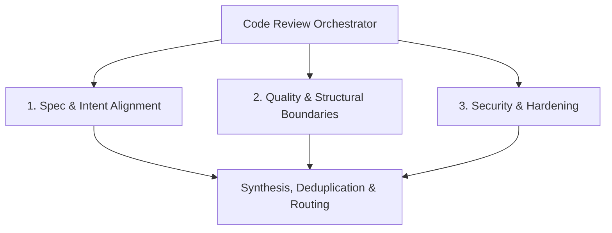

# Code Review Gate

Code Review is an atomic semantic and structural verification gate.
It evaluates pull requests, commits, and diffs beyond test passes.
The gate verifies state soundness, failure resiliency, intent alignment, and clean architectural boundaries.

The gate operates under `keel`[^keel] Judgment mode and `coding-protocol`[^coding-protocol] Evidence state.

---

## The Line Count Invariant

Line count is never an independent defect metric.
A 200-line cohesive module with a deep interface is superior to ten shallow classes.
Reviewers focus on clear boundary seams, encapsulation, and low cognitive coupling.
Functions over 60 lines or files over 400 lines trigger structural triage, not automatic rejection.

---

## Multi-Agent Architecture (Option A)

The orchestrator coordinates three parallel, isolated subagents:



### 1. Spec & Intent Alignment (`spec-intent`)[^mattpocock]

- **Role**: Primary review axis. Validates implementation fidelity against user intent.
- **SOT Hierarchy**: Pinned technical spec > Issue tracker criteria > Commit messages.
- **Degraded Mode**: When no specification exists, infers provisional intent from tests. Emits `[HIGH] intent-unverifiable` and caps route at `remediate`.
- **Audits**: Missing requirements, material spec drift, unrequested behavior, and scope creep.

### 2. Code Quality & Structural Boundaries (`quality-boundaries`)[^addy-quality][^addy-simplify][^keel][^programming-expert]

- **Role**: Combines implementation quality, test refutability, and structural seam governance.
- **Intra-File Quality (VDD)**: Rejects paper tiger mocks, tautological assertions, and silent exception swallows.
- **Inter-Module Seams**: Enforces Clean Architecture inward dependencies and Ousterhout's Deep Design. Preserves exact behavior.
- **Size Triage Trigger**: Audits large functions (>60 lines) or files (>400 lines) for state leaks and mixed responsibilities.

### 3. Security & Hardening (`security-hardening`)[^addy-security]

- **Role**: Threat modeling and vulnerability defense.
- **STRIDE Analysis**: Audits spoofing, tampering, repudiation, information disclosure, denial of service, and privilege escalation.
- **Defenses**: Verifies boundary input validation, injection resistance, secret protection, LLM output guards, and fail-closed concurrency.

---

## Operating Protocol

1. **Evidence State Only (`coding-protocol`[^coding-protocol])**:
   - Reviewers hold judgment authority only, never mutation authority.
   - Reviewers never edit files, fix bugs, or rewrite code.
2. **Scale by Risk**:
   - Skip formatting, whitespace, syntax, and style issues covered by linters.
   - Surface only actionable `[BLOCKING]`, `[HIGH]`, and significant `[INFO]` defects.
3. **Subagent-First Isolation**:
   - Subagents execute concurrently in fresh, isolated contexts.
   - Subagents evaluate objective artifacts without author rationalizations.

---

## Three-Phase Review Workflow

### Phase 1: Ingest Evidence & Pre-Package Bundle

1. Generate the review bundle with `$SKILL_DIR/scripts/review_package.py`[^superpowers]:
   ```bash
   uv run $SKILL_DIR/scripts/review_package.py [base] [head] --spec <path>
   ```
   This creates a consolidated bundle with commit log, diffstat, extended context diff (`-U10`), and specification.
2. Run deterministic pre-scan with `$SKILL_DIR/scripts/review_gate.py`:
   ```bash
   uv run $SKILL_DIR/scripts/review_gate.py scan-diff --diff-file <path>
   ```
   Flags empty exception handlers, skipped tests, and illegal boundary imports.

### Phase 2: Dispatch 3 Parallel Subagents

Dispatch the three subagents concurrently with the review bundle:

- Subagent 1 (`spec-intent`): Audits intent alignment and scope containment.
- Subagent 2 (`quality-boundaries`): Audits test refutability, code clarity, and structural seams.
- Subagent 3 (`security-hardening`): Audits threat vectors and boundary defenses.

### Phase 3: Synthesize, Deduplicate, and Route

1. Present subagent reports side-by-side under dedicated headings.
2. Deduplicate overlapping findings targeting identical `file:line` locations using `$SKILL_DIR/scripts/review_gate.py`.
3. Apply tie-break precedence when trade-offs conflict:
   `Intent > Security > Structural > Standards`.
4. Compute the workflow route:
   - `continue`: Quality score $\ge 8$, zero `BLOCKING` or `HIGH` issues, intent verified, SOT in sync.
   - `remediate`: Quality score $< 8$, any `BLOCKING` or `HIGH` defect, or material intent drift.
   - `blocked`: Critical architectural failure or irrecoverable specification contradiction.

---

## Mandatory Response Contract

Format outputs per the standard inter-agent response contract:

```markdown
## Summary

<Concise technical assessment of intent alignment, structural seams, and security posture>

## Route

continue | remediate | blocked

## Issues

- [BLOCKING|HIGH|INFO] <file>:<line> (<invariant>): <concise defect title>

## Subagent Reports

### Spec & Intent Alignment

- Status: Aligned | Degraded | Drifting
- Findings: <actionable items or confirmation>

### Quality & Structural Boundaries

- Status: Clean | Needs Simplification | Seam Leak
- Findings: <actionable items or confirmation>

### Security & Hardening

- Status: Secure | Vulnerable
- Findings: <actionable items or confirmation>

## Gate Verdict

Score: <1-10>/10 (Threshold: 8)
Status: PASS | FAIL
SOT Sync: In Sync | Drift Detected (<details>)
```

---

## References & Tools

- [Design Contract](references/design-contract.md): Full contract governing subagents, SOT hierarchy, and tie-breaks.
- [Crux Rubric](references/crux-rubric.md): Concrete examples of paper tigers, anti-laziness patterns, and seam leaks.
- Review Package Generator: `$SKILL_DIR/scripts/review_package.py` creates consolidated diff and spec bundles.
- Deterministic Review Gate: `$SKILL_DIR/scripts/review_gate.py` runs AST scans and validates verdicts.

---

## Footnote References

[^mattpocock]: https://github.com/mattpocock/skills/blob/main/skills/engineering/code-review/SKILL.md

[^addy-quality]: https://github.com/addyosmani/agent-skills/tree/main/skills/code-review-and-quality

[^addy-simplify]: https://github.com/addyosmani/agent-skills/tree/main/skills/code-simplification

[^addy-security]: https://github.com/addyosmani/agent-skills/tree/main/skills/security-and-hardening

[^superpowers]: https://github.com/obra/superpowers/tree/main/skills/subagent-driven-development/scripts/review-package

[^keel]: skills/keel/SKILL.md

[^coding-protocol]: skills/coding-protocol/SKILL.md

[^programming-expert]: skills/programming-expert/SKILL.md
