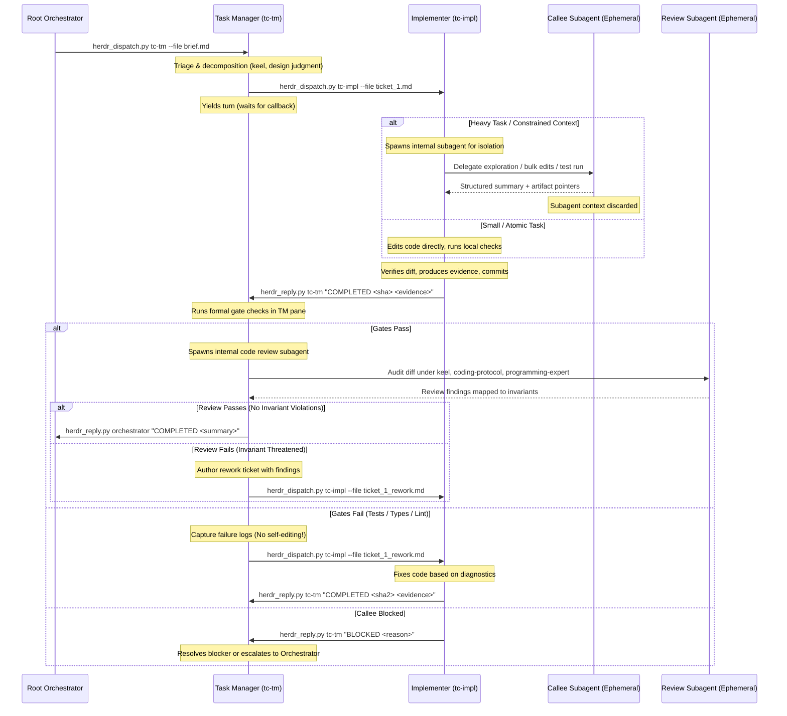

# Hierarchical Lane Coordination (Task Manager <-> Implementer)

Depth for `$SKILL_DIR/SKILL.md`. Architecture, role boundaries, and contract protocols for multi-tier Herdr lanes where an in-lane Task Manager coordinates one or more Implementers.

> [!IMPORTANT] Method Constraint
> Always use harness scripts in `$SKILL_DIR/scripts/` (e.g. `herdr_dispatch.py`, `herdr_reply.py`, `herdr_prompt.py`, `herdr_overview.py`), NOT bare `herdr` CLI commands, for lane coordination, task dispatch, and completion replies.

## Which part of this file you need

- Multi-agent boundaries and anti-patterns: [Context and Delegation Architecture](#context-and-delegation-architecture).
- Lane topology and revision bumps: [Lane Topology & Revisions](#lane-topology--revisions).
- Orchestrator, Task Manager, and Implementer duties: [Role Boundaries and Authority Contracts](#role-boundaries-and-authority-contracts).
- Deliverables and ownership: [Artifact Ownership Matrix](#artifact-ownership-matrix).
- Dispatch and brief templates: [Canonical Prompt Contracts](#canonical-prompt-contracts).
  - Orchestrator to TM brief: [Root Orchestrator to TM Brief Contract](#root-orchestrator-to-tm-brief-contract).
  - TM to Implementer ticket: [TM to Implementer Ticket Contract](#tm-to-implementer-ticket-contract).
  - Implementer to TM reply: [The Final Reply Template](#the-final-reply-template).
  - Adversarial code review: [TM to Internal Code Review Subagent Contract](#tm-to-internal-code-review-subagent-contract).
  - Frontmatter samples and correlation: [A2A Frontmatter Envelope and Correlation IDs](#a2a-frontmatter-envelope-and-correlation-ids).
  - Trimmed caller stdout: [Caller Delivery Summary](#caller-delivery-summary).
  - Ticket and task correlation IDs: [Ticket-ID and Task-ID Contract](#ticket-id-and-task-id-contract).
  - Scoped agent naming: [Scoped-Prefix Rule](#scoped-prefix-rule).
- End-to-end sequence: [Execution Lifecycle](#execution-lifecycle).
- In-pane context isolation: [Context Isolation via Subagents](#context-isolation-via-subagents).
- Leases, readiness, and storage: [Advanced Communication and Coordination Protocol](#advanced-communication-and-coordination-protocol).
  - Async turn model: [1. Dispatch-and-Yield](#1-dispatch-and-yield).
  - Concurrency locks and task states: [2. Task Leases and Trajectories](#2-task-leases-and-trajectories).
  - Agent delegation state: [3. Token Observability and Delegation Detection](#3-token-observability-and-delegation-detection).
  - Subagent boundaries: [4. The Iron Curtain and Unified Message Format](#4-the-iron-curtain-and-unified-message-format).
  - Branch merges: [5. Superset Task-Branch Integrations](#5-superset-task-branch-integrations).

---

## Context and Delegation Architecture

When a workflow requires high-level coordination and focused execution, the Root Orchestrator provisions an in-lane **Task Manager (TM)** alongside one or more **Implementers (Callees)** in dedicated panes within a shared workspace or tab.

`herdr_prompt.py` and `herdr_dispatch.py` open every dispatch with the script-rendered A2A frontmatter envelope (`sender`/`receiver` addresses, correlation IDs, live `group` roster), close it with the Herdr skill notice, and end with the reply contract. The canonical sample lives in `$SKILL_DIR/SKILL.md` under **Know your post**.

> [!IMPORTANT] Name Every Pane Immediately
> Unlabeled panes cause blind spots in `herdr_overview.py` and break automated reply routing. Name each pane with text matching its role (`orchestrator`, `task-manager`, `impl-auth`, `reviewer`) using `herdr-pane --label` or `herdr-label`.

> [!NOTE] Receiver Target Parsing
> The `metadata.group` roster lists participants as `name@pane_id`. The target passed to `herdr_dispatch.py` or `herdr_prompt.py` is the live agent name before `@` or the pane ID. These are the only targets `herdr agent prompt` accepts. Pane labels do not serve as direct targets.

### Core Anti-Patterns & Their Tells

| Anti-Pattern | Definition | The Tell That Exposes It | Failure Mode & Impact |
|---|---|---|---|
| **Anchored Brief** | Orchestrator performs deep code reconnaissance and bakes line-level implementation maps or design choices into the TM brief. | Brief specifies exact line numbers, private function names, AST details, internal state indices, or pre-decided algorithms. | Pre-empts TM triage, strips TM architectural ownership, and forces TM into a passive router. |
| **Router TM** | TM fails to exercise decomposition, scoping, or design judgment, acting merely as a pass-through relay. | Callee tickets copy-paste the brief verbatim; TM makes zero exploratory tool calls; tickets lack independent scoping or evidence criteria. | Callees receive un-scoped tickets; edge cases and module invariants are ignored; verification becomes superficial. |
| **Hero-Mode TM** | TM implements code changes directly instead of delegating to assigned callees. | Assigned callees in `metadata.group` remain idle; TM tool calls are dominated by file edits and compile loops; TM context exhausts. | Multi-agent topology is bypassed; division of labor is lost; TM suffers context compaction degradation. |

### Two-Tier Delegation Architecture: Lane Coordination vs. Role-Internal Subagents

> [!IMPORTANT] Subagent-First Execution Mandate
> All coding agents across all engines (`pi`, `claude`, `agy`, `cursor`, `cline`, `codex`, `gemini`, `qodercli`) MUST delegate heavy tasks to subagents:
> - **Implementers**: MUST delegate deep exploration (Scout), bulk multi-file editing (Editor), and test failure log triage (Test Runner) to ephemeral subagents. Host panes synthesize and verify before committing.
> - **Task Managers**: MUST delegate crux adversarial code review under `keel`, `coding-protocol`, and `programming-expert` to an internal review subagent.

1. **Tier 1: Lane-Level Coordination (Herdr Inter-Pane)**
   - **Topology**: Root Orchestrator ↔ Task Manager ↔ Implementers across dedicated Herdr panes.
   - **Protocol**: Event-driven via `herdr_dispatch.py` and `herdr_reply.py` governed by Task Leases and Token Observability.
   - **Scope**: In-lane execution inside the role's provisioned worktree (`<repo>.<task-group>.<role>`): lane planning, ticket dispatch, verification gates, code review verdicts, status triad (`COMPLETED`, `BLOCKED`, `REJECTED`).
   - **Rule**: Even single-ticket lanes go `Orch → TM → Impl`: the orchestrator provisions one worktree per role and the topology, but never dispatches callee tickets directly. Each writer owns exactly one worktree, and a branch is checked out in exactly one worktree. TM and Implementers run natively inside their assigned worktrees from turn zero. Reviewers evaluate a pinned SHA on a read-only tree.
   - **Lifecycle**: Branches follow `lane/<task-group>/<role>/<ticket>`. `herdr-worktree claim` moves a clean tree onto its branch from an explicit base and records it in `.lane/tasks.yaml`. Inspect [agent-bootstrap](agent-bootstrap.md) for the `--cwd` matrix. A tree still named `<repo>.<sanitized-branch>` instead of `<repo>.<task-group>.<role>` is reported as `layout`; `status` prints the migration command for it — `retire` the old tree, then `claim` the same branch into the canonical name — and `doctor` carries the same flag.
   - **Commit-addressed review**: Freeze review targets at a SHA. Inspect using `git diff <base>..<sha>` and `git show <sha>:<path>`. Never mutate the implementer's tree to reproduce a review.

2. **Tier 2: Role-Internal Subagent Delegation (Context Isolation)**
   - **Topology**: Host pane ↔ Ephemeral platform subagents (`Agent`, `invoke_subagent`, scratch tasks).
   - **Scope for Implementer**: Deep codebase exploration (Scout), bulk edits (Editor), and verbose test runs (Test Runner) isolated to disposable contexts.
   - **Scope for Task Manager**: Adversarial crux code review (`keel`, `coding-protocol`, `programming-expert`) delegated to an internal review subagent to keep TM context clean and verdicts objective.
   - **The Iron Curtain**: Internal subagents are strictly private to the hosting pane. They **NEVER** invoke Herdr CLI commands, **NEVER** manage panes, and **NEVER** call `herdr_reply.py`. The host agent owns all external lane communication.

---

## Lane Topology & Revisions

The standard lane topology is two tabs: the orchestrator alone in one tab, and a crew tab with the Task Manager and the Implementer side by side. Roles stay the same; only their placement is standardised.

### Bringing Up The Topology

Six commands, in order. Ids are read from responses, never predicted. The lane helper runs exactly this sequence (`herdr-lane up`, with `--dry-run` to print it); the commands below are what it executes, and what to do by hand if it has not been run.

```bash
# Orchestrator tab: one pane.
herdr tab create --label <prefix> --cwd <orch-worktree> --focus    # read .result.tab
herdr-bootstrap --pane <orch-pane> --kind agy --role orch --task-group <prefix> --cwd <orch-worktree>

# Crew tab: TM left, Implementer right.
herdr tab create --label <prefix>-crew --cwd <tm-worktree>        # read .result.tab
herdr-pane horizontal --pane <tm-pane> --cwd <impl-worktree>       # prints the new pane id
herdr-bootstrap --pane <tm-pane> --kind pi --role tm --task-group <prefix> --cwd <tm-worktree>
herdr-bootstrap --pane <impl-pane> --kind pi --role impl --task-group <prefix> --cwd <impl-worktree>
```

`herdr tab create` names the tab in its response (`.result.tab`); the tab's first pane id is not named there, so read it from `herdr pane list` for that tab. `herdr-pane horizontal` maps to `herdr pane split --direction right` and prints the pane it created — a lane that wants a stacked crew uses `vertical` instead.

> [!WARNING] Tab labels are not unique
> An exact label resolves to every match, so `herdr-overview --tab <label>` widens silently when two tabs share a label. Keep the lane prefix unique and let revisions carry the difference.

### Revision Bumps

A revision marks a respawn event on the tab label, and nothing else. The slug, agent names, worktrees, branches, leases, and store records are untouched: a tab rename is display-only, and the envelope binds the slug to the physical `tab_id`, never to the label.

```bash
# 1. Respawn in place: same pane id, same worktree, same agent name.
herdr-bootstrap --pane <pane> --kind pi --role <role> --task-group <prefix> --cwd <worktree>

# 2. Mark the event on the tab, monotonic by one.
herdr-label --tab <prefix>-r<N+1>
```

The revision increments once per respawn event and is monotonic for the life of the lane. After the bump, `herdr-overview --tab <prefix>-r<N+1>` is the live view; the previous label names nothing. Leases and trajectories keep running across a respawn, so a reply that lands after a bump still resolves against the same `<slug>@<tab_id>`.

**Accepted limitation:** a respawn of one role bumps the revision for the whole tab. The tab reports the latest respawn event, not a per-pane generation: after the Implementer alone is respawned, the Task Manager pane is older than the label says. Per-pane precision would require renaming agents per generation, and agent names are the dispatch address (`<slug>-<role>`), so a rename breaks in-flight addressing. That is out of scope by decision; the tab label is the granularity the topology offers.

**Teardown:** there is no `agent stop`. Exit the agent in its pane — it leaves a shell prompt, which is exactly what the next `herdr-bootstrap --pane` needs — or `herdr pane close <pane-id>` when the generation shrinks. Never rebuild a worktree to respawn: the pane is the unit.

---

## Role Boundaries and Authority Contracts

### Root Orchestrator Contract

The Root Orchestrator owns problem definition, global constraints, topology provisioning, and final delivery verification. It does not dictate implementation mechanics or pre-empt in-lane design decisions.

- **Bound Architectural Skills**:
  - `keel`: Identify affected module boundaries, seams, and cross-cutting invariants at a high level.
  - `coding-protocol`: Frame the verification contract—specify what observable empirical evidence proves completion, without prescribing line-level edits.
- **Reconnaissance Budget (Go/No-Go Sizing Only)**:
  - **Allowed Sizing Scope**:
    1. *Seam inventory*: Number of module boundaries or public interfaces affected.
    2. *Dependency impact*: External dependencies or build tools introduced.
    3. *Existing test coverage*: Existing test suites or fixtures versus required harness bootstrapping.
    4. *Topology sizing*: Sizing magnitude (S/M/L) to allocate sufficient implementer panes.
  - **Forbidden Internals**:
    1. Reading private functions or state tables to craft an implementation map.
    2. Specifying line numbers, read sites, or specific statement edits.
    3. Pre-deciding design choices (precedence order, algorithms, data structures).
    4. Slicing tasks into code-granular sub-steps for the TM.

#### Worked Reconnaissance Examples

> [!TIP] Positive Example: Allowed Orchestrator Sizing Output
> ```markdown
> ## Sizing & Boundaries
> - Seams touched: 1 seam between the CLI options parser (`src/cli/args.py`) and config loader (`src/config/loader.py`).
> - Dependencies: Standard library only; no new external packages.
> - Test baseline: Pytest suite exists for loader (`tests/test_loader.py`); CLI flags require new regression coverage.
> - Sizing: Small (S) — single-ticket lane with 1 implementer.
> ```

> [!WARNING] Negative Example: Forbidden Orchestrator Over-Reach (Anchored Brief)
> ```markdown
> ## Implementation Plan (FORBIDDEN)
> - In `clients/tool-agreement.ts` at line 42, modify `resolveAgreement()` to read from `bucketTable` at index 2.
> - Use lockfile precedence Yarn > Pnpm > Npm; tolerate pnpm-v6 by checking `packageManager` in package.json.
> - Keep `test_agreement` green by updating the mock at line 88 to return `{ status: 'ok' }`.
> ```

- **Explicit Allow List**:
  - Confirm role-to-agent mapping (role, agent kind, provider, model) before lane provisioning.
  - Claim one isolated worktree per role with `uv run ${herdr_skill}/scripts/herdr_worktree.py claim <path> lane/<task-group>/<role>/<ticket> --base <ref>`, allocate panes and tabs, and launch each with `--cwd` set to that role's path.
  - Label every pane immediately with meaningful text matching its role.
  - Boot TM and Implementers with verified bootstrap flags.
  - Issue brief to TM specifying intent, constraints, acceptance criteria, verification contract, and sizing budget.
  - Re-brief or escalate when TM reports `BLOCKED` or `REJECTED`.
  - Run final release/audit gate on lane completion.
- **Explicit Forbid List**:
  - Reading implementation internals to build an implementation plan.
  - Pre-deciding design trade-offs belonging to the TM.
  - Writing code-granular or line-level requirements in the brief.
  - Editing source, test, or config files directly.
  - Bypassing TM to dispatch tickets directly to lane callees.

---

### Task Manager Contract

The Task Manager owns in-lane triage, decomposition, scope boundaries, design judgment, ticket authoring, verification gate execution, and code review verdicts.

- **Bound Architectural Skills**:
  - `keel`: Discover and govern architectural seams, module boundaries, and domain state invariants. Prevent structural drift, hidden coupling, or leaky abstractions.
  - `coding-protocol`: Risk-scaled execution, evidence standards, and explicit verification contracts (`[action] -> [check]`). Demand concrete test evidence from callees.
  - `programming-expert`: Language correctness, idiomatic implementation, error handling, type soundness, and deep design (narrow interfaces, absorbing complexity). Distinguish design deepening from scope creep.
- **Mandatory Review Lens**:
  - Every review finding MUST explicitly map to the invariant it threatens.
  - Green gate passes (tests, linter) are necessary but NEVER sufficient; an explicit review verdict is required for every ticket.
- **Code Review via Internal Subagents**:
  - The TM MUST use internal ephemeral subagents for code review.
  - Spawns an internal subagent equipped with `keel`, `coding-protocol`, and `programming-expert` to review the callee diff.
  - Subagent returns structured review findings with invariant mapping; TM renders the formal review verdict.
- **Explicit Allow List**:
  - Decompose orchestrator brief into atomic, single-intent tickets.
  - Exercise independent design judgment on data structures, algorithms, interfaces, and refactoring depth.
  - Author tickets specifying target files, scope boundaries, constraints, and explicit test/evidence requirements.
  - Dispatch tickets to callees via `herdr_dispatch.py` and await `herdr_reply.py`.
  - Run verification gates in the TM pane against callee diffs at a pinned SHA. Inspect via `git diff <base>..<sha>` and `git show <sha>:<path>`.
  - Spawn internal subagents for code review under `keel`, `coding-protocol`, and `programming-expert`.
  - Issue review verdicts (`PASS`, `REWORK`, `REJECT`) mapping findings to threatened invariants.
  - Dispatch rework tickets on gate failures or review findings with targeted diagnostics.
  - Synthesize lane status to orchestrator via `herdr_reply.py`.
- **Explicit Forbid List**:
  - Editing source, test, or config files directly ("Hero-Mode TM").
  - Running iterative fix loops directly in the TM pane.
  - Acting as a pass-through router ("Router TM") that forwards brief requirements without decomposition.
  - Accepting green gates as a substitute for code review without an explicit review verdict.
  - Treating cohesive internal refactoring as scope creep when it strengthens invariants.
  - Allowing internal subagents to invoke Herdr CLI or `herdr_reply.py`.

---

### Implementer Contract

The Implementer owns execution, mutation, and concrete evidence production. It translates assigned ticket requirements into atomic, verified commits.

- **Bound Architectural Skills**:
  - `keel`: Respect structural boundaries and module seams. Adhere to domain invariants and interface contracts established by the ticket.
  - `coding-protocol`: Risk-scaled execution, red-first replayable test evidence, minimal diffs, atomic commits.
  - `programming-expert`: Language idioms, strict typing, rigorous error handling, resource cleanup, and robust test coverage.
- **Concrete Evidence Requirement**:
  - The implementer must produce concrete, replayable evidence (red-then-green test runs, linter passes, diff summaries, commit SHAs), NOT a mere textual assertion of quality.
- **Context Isolation via Internal Subagents**:
  - Delegates heavy search, bulk editing, or verbose test triage to ephemeral internal subagents to prevent context compaction degradation.
- **Explicit Allow List**:
  - Read assigned ticket requirements and constraints.
  - Spawn internal subagents for context isolation (Scout, Editor, Test Runner).
  - Edit source code and tests to fulfill ticket requirements.
  - Run local test, lint, and typecheck checks.
  - Produce concrete execution evidence (reproducibility traces, red-then-green logs).
  - Make atomic commits matching ticket scope.
  - Aggregate results and reply to TM via `herdr_reply.py`.
- **Explicit Forbid List**:
  - Expanding scope beyond ticket boundaries.
  - Attempting lane-level orchestration (dispatching to other Herdr panes or agents).
  - Modifying architectural boundaries or public seams unasked.
  - Producing assertions of quality without concrete replayable evidence.
  - Allowing internal subagents to invoke Herdr CLI or `herdr_reply.py`.

---

## Artifact Ownership Matrix

Each artifact in the lane coordination lifecycle has **exactly one author role**:

| Artifact | Author Role | Consumer Role | Purpose & Binding Standard |
|---|---|---|---|
| **Brief** | Root Orchestrator | Task Manager | Global intent, constraints, acceptance criteria, verification contract, and sizing budget. Free of line-level internals. |
| **Ticket** | Task Manager | Implementer | Decomposed task specification with bounded scope, test criteria, and evidence expectations. |
| **Diff** | Implementer | Task Manager | Source, test, and config mutations fulfilling ticket requirements. Accompanied by atomic commit. |
| **Gate Output** | Task Manager | Task Manager / Orchestrator | Verbatim logs from formal test, lint, and typecheck suites executed in the TM pane against the callee diff. |
| **Review Verdict** | Task Manager | Task Manager / Implementer | Semantic evaluation under `keel`, `coding-protocol`, and `programming-expert` (authored via TM review subagent), mapping every finding to the invariant it threatens. |
| **Completion Callback** | Task Manager | Root Orchestrator | Final lane delivery report (`COMPLETED`, `BLOCKED`, `REJECTED`) containing branch name, commit SHAs, gate output summary, and review findings. |
| *(Callee Callback)* | Implementer | Task Manager | Intra-lane progress report (`COMPLETED`, `BLOCKED`, `REJECTED`) containing commit SHA and concrete test evidence. |

---

## Canonical Prompt Contracts

### The Injected Context Header & Caller Recovery

Every dispatch initiated via `herdr_dispatch.py` or `herdr_prompt.py` injects the frontmatter envelope at turn zero, before the ticket payload (see **Know your post** in `$SKILL_DIR/SKILL.md`). The envelope carries lane topology and correlation IDs for context fidelity. `metadata.receiver` names the addressee. `herdr_reply.py` wraps completion replies in the same envelope.

- **Caller recovery (`kind + session_path + cwd`)**: Dispatch persists caller environment coordinates as `caller_recovery` in `.lane/tasks.yaml`. Recovery is retrieved just-in-time when a reply target has exited or is a bare shell. Passing `--verbose` adds `cwd`/`resume` back into `metadata`.
- **Addresses**: `metadata.sender` and `metadata.receiver` carry strict `<agent>@<pane>` addresses. The tab rides inside `metadata.task_group` (`<slug>@<tab_id>`), and sender session rides as `context_id`.
- **`group` roster**: `metadata.group` lists lane participants as `name@pane_id`, sender first. The lane is the task-group slug: with one, the roster is every live agent named `<slug>-…` in the sender's and receiver's workspaces plus the addressing pair — the sender always, and any addressed target even when its name carries no slug (`orchestrator`, `reviewer`), because being party to the message is what puts a pane in the lane. Without a slug it falls back to every live agent in those workspaces. The roster stays informational: the target passed to `herdr_dispatch.py` or `herdr_prompt.py` is the agent name before `@` (e.g. `impl-1`).

---

### Root Orchestrator to TM Brief Contract

The orchestrator brief defines the problem, boundary constraints, acceptance criteria, verification contract, and sizing budget:

```markdown
# TASK: <Feature / Bug Name>

Lane: `<lane-label>` | TM: `<tm-name>` | Callees: `<callee-names>`
Role Assignment: TM=`<kind>` (`<provider>/<model>`), Callees=`<kind>` (`<provider>/<model>`) [Bootstrap: `<flags>`]

## Role & Delegation Mandate
You are the **Task Manager** for this lane. You hold **coordination, design judgment, and review authority ONLY**.
- **HARD CONSTRAINT**: Do NOT edit source code, test files, or configuration files directly.
- **DELEGATION**: Decompose requirements into atomic tickets and dispatch them to callee(s) (`<callee-names>`) using:
  `uv run ${herdr_skill}/scripts/herdr_dispatch.py <callee-name> --file <ticket-path>`
  *(Pass only the callee agent name before `@`, e.g., `impl-1`).*
- Await completion via `herdr_reply.py` callbacks.
- **CODE REVIEW MANDATE**: On receiving callee completion, run verification gates AND spawn an internal subagent to conduct an adversarial crux code review under `keel`, `coding-protocol`, and `programming-expert`.
- Note: Native platform subagent calls (`Agent` tool) in your pane are reserved for code review and triage; use exclusively the Herdr callees listed above for code mutation.

## Intent (IDD) & Goals (GDD)
- **Problem**: <High-level deficiency, friction, or behavioral regression in current world state>
- **Proposed Outcome**: <Observable change in behavior or capability once resolved>
- **Non-Negotiable Constraints**: <Backwards compatibility, community rules, performance ceilings, forbidden patterns>

## Acceptance Criteria (BDD)
<Observable behavioral criteria (Given/When/Then scenarios)>

## Verification Contract (EDD)
<Which command proves completion, expected gate results, and who verifies what>

## Sizing & Seams (Reconnaissance Budget)
- Seams touched: <Module boundaries affected>
- Dependencies: <External package additions or modifications>
- Test baseline: <Existing test fixtures vs required new coverage>
- Sizing: <S/M/L estimate and callee topology suggestion>

## Reporting
On gate pass and review approval, reply to the sender using the Final Reply Template:
  `uv run ${herdr_skill}/scripts/herdr_reply.py <sender-name> "<STATUS> <summary>" --ticket '<ticket-id>'`
```

---

### TM to Implementer Ticket Contract

Every ticket dispatched to a callee pairs upstream teleological purpose (**IDD**) with downstream verifiable targets (**GDD/EDD**):

```markdown
# TICKET / BRIEF: <ID> — <Title>

Target files / Seams: <paths or boundary definitions>

## 1. Intent (IDD)
- **Problem**: <Concrete deficiency, friction, or behavioral regression in current world state>
- **Proposed Outcome**: <Observable change in behavior, capability, or invariant once resolved>
- **Non-Negotiable Constraints**: <Invariants, boundary rules, banned patterns, backwards compatibility>

## 2. Verification Contract (GDD/EDD)
- **Check Command**: `<deterministic command proving environmental truth, e.g. uv run pytest tests/...>`
- **Required Evidence**: `<concrete proof required: red-then-green test logs, exit code 0, commit SHA>`

## 3. Execution Strategy (Subagent-First Mandate)
- Delegate heavy codebase exploration (Scout), multi-file code editing / refactoring (Editor), and test failure log triage (Test Runner) to ephemeral platform subagents.
- Keep the callee host pane context lean: ingest only summaries, diffs, and artifact paths from subagents.
- **The Iron Curtain**: Never let subagents call Herdr CLI commands or scripts (`herdr_reply.py`, `herdr_dispatch.py`). Aggregate all results in this host pane.

On completion, reply to the caller in one message using the herdr helper script:
  uv run ${herdr_skill}/scripts/herdr_reply.py <sender-name> --file <reply-payload.md> --ticket '<ticket-id>'
  # (Or inline: uv run ${herdr_skill}/scripts/herdr_reply.py <caller-name> "<PAYLOAD>" --ticket '<ticket-id>')
```

---

### The Final Reply Template

All completion replies delivered via `herdr_reply.py` adhere to the response format defined in `skills/ai-engineering-expert/references/resp-format.md`. `herdr_reply.py` prepends the frontmatter envelope:

```markdown
COMPLETED <commit-sha>
<!-- Or: BLOCKED <concise-reason> | REJECTED <invariant-violation-reason> -->

## Summary
<Carmack-style delivery: technical approach, architectural rationale, state tradeoffs, ≤100 words>

## Artifacts
- <absolute/path/to/file> (<diff | spec | report | eval | pr>)

## Evidence
- <check_name>: PASS | FAIL (`<command>`) [tail ≤20 lines on failure]

## Route
continue | remediate | blocked

## Issues
- [P1|P2|P3] <file>:<line> — <Invariant / Contract>: <Defect description>. Remediation: <Concrete fix>
<!-- Or: None -->

## Suggestions (Optional)
- [<Category>] <observation>. Workaround: <workaround>. Suggestion: <suggestion>
```

The ledger records normalized label `evidence` from `## Evidence`, outranking earlier `## Artifacts` sections.

#### Status Triad & Routing Semantics
- **Status Triad**:
  - `COMPLETED <commit-sha>`: All requirements met, all verification checks green, clean commit created.
  - `BLOCKED <reason>`: Unresolvable environmental blocker, missing dependencies, or contradictory specification.
  - `REJECTED <reason>`: Requested change violates codebase invariants, architectural boundaries, or security constraints.
- **Route**:
  - `continue`: 0 P1/P2 issues AND all verification checks green. Ready to merge.
  - `remediate`: P1/P2 issues exist or tests failed, but remediation within the callee is possible.
  - `blocked`: Unresolvable conflict; escalate to Task Manager or Orchestrator.

---

### TM to Internal Code Review Subagent Contract

When callee signals completion, the TM invokes an internal review subagent:

```markdown
Role: Adversarial Crux Code Reviewer
Task: Audit the callee diff for ticket `<ticket-name>` against codebase invariants.

## Review Lens & Standards
Evaluate the diff strictly against three architectural skills:
1. `keel`: Seam integrity, architectural boundaries, aggregate invariants, and anti-drift.
2. `coding-protocol`: Risk-scaled execution, evidence refutability, diff minimalism.
3. `programming-expert`: Language correctness, strict typing, error handling, resource cleanup, and deep design.

## Verification Inputs
- Ticket: `<path-to-ticket.md>`
- Commit / Diff: `git diff <base-sha>..<callee-sha>`
- Gate Output: `<path-to-gate-log or summary>`

## Return Contract
Return a structured review verdict:
- Verdict: PASS | REWORK | REJECT
- Findings: List of issues, where EACH finding explicitly names the exact invariant or contract it threatens (or "No invariant violations observed").
- Recommendations: Targeted, actionable rework instructions if needed.
```

---

### A2A Frontmatter Envelope and Correlation IDs

Every message dispatched or replied via `herdr_prompt.py`, `herdr_dispatch.py`, and `herdr_reply.py` renders one A2A Markdown frontmatter block (`docs/adr/0020-a2a-markdown-frontmatter-envelope.md`) with four top-level keys: `id`, `context_id`, `status`, and `metadata`. The opening and closing `---` delimiters wrap the metadata, followed immediately by the Herdr skill notice line.

Dispatch envelope:

```text
---
id: '#182-herdr-msg-enhance#impl-bootstrap'
context_id: pi-8f2c1d
status:
  state: TASK_STATE_WORKING
  timestamp: '2026-10-05T06:19:12.983Z'
metadata:
  ticket_id: '#182-herdr-msg-enhance'
  sender: msg-tm@w1:p1
  receiver: msg-impl-1@w1:p3
  task_group: msg-enhance@w1:t1
  group:
  - msg-tm@w1:p1
  - msg-impl-1@w1:p3
---
Herdr: follow the herdr skill — run its helper scripts from ${herdr_skill}/scripts/ for all coordination, never the bare herdr CLI

<ticket body>
```

Reply envelope:

```text
---
id: '#182-herdr-msg-enhance#impl-bootstrap'
context_id: pi-3a9e7b
status:
  state: TASK_STATE_COMPLETED
  timestamp: '2026-10-05T06:31:04.117Z'
metadata:
  ticket_id: '#182-herdr-msg-enhance'
  sender: msg-impl-1@w1:p3
  receiver: msg-tm@w1:p1
  task_group: w1:t1
  in_reply_to: '#182-herdr-msg-enhance#impl-bootstrap'
---
Herdr: follow the herdr skill — run its helper scripts from ${herdr_skill}/scripts/ for all coordination, never the bare herdr CLI

<STATUS> <artifacts> <issues>
```

#### Caller Delivery Summary

The caller stdout echo is trimmed to prevent terminal flooding. Both dispatch and reply print:
- **First line**: Identity anchor `[You: <agent>@<pane>]` followed by target, byte count, revision, and state.
- **Delimiters & Metadata**: Frontmatter key lines between `---` delimiters (omitting the repeated skill notice).
- **Source**: Origin line (`File: <path>` or `Payload: inline/stdin`).
- **Body preview**: Up to 3 lines, or head and tail with line-skip count.
Pass `--json` to output machine-parseable JSON instead.

#### Ticket-ID and Task-ID Contract

- **Ticket-ID** identifies the dispatched ticket, shaped `[REF]-[slug]` (e.g. `#182-herdr-msg-enhance`). `herdr-dispatch --ticket-id` sets it explicitly; otherwise the dispatcher derives it from the ticket filename.
- **Task-ID** identifies one task inside that ticket, shaped `<ticket-id>#<task-slug>`. `herdr-dispatch --task-id` binds it explicitly; otherwise it mirrors the Ticket-ID. It keys the task record in `.lane/tasks.yaml` and rides as the envelope `id`.
- `herdr_reply.py` populates `id`, `metadata.ticket_id`, and `metadata.in_reply_to` from the sender's active lease, appends the status to the task trajectory, and releases the sender's lease. Explicit `--ticket <ID>` or `--in-reply-to <RECORD>` overrides lease resolution.
- Outbound payloads are verified before recording: every backticked 7-40 hex token must resolve as a commit (`git rev-parse --verify <tok>^{commit}`); one that drifts by a digit points at nothing (#247). An unresolvable token aborts the reply with exit 2 naming the token and payload path; deliberate non-commit tokens must be waived via `--allow-unresolvable-sha <TOKEN>`.

#### Scoped-Prefix Rule

Every lane agent name is `<task-group-slug>-<role>[-<subrole|index>]` (e.g. `msg-orch`, `msg-tm`, `msg-impl-1`). Passing `--task-group <slug>` prefixes a bare role (`uv run ${herdr_skill}/scripts/herdr_bootstrap.py --role tm --task-group msg` → `msg-tm`). The scoped name serves as both pane label and agent name, satisfying `[a-z][a-z0-9_-]{0,31}` (max 32 chars).

---

## Execution Lifecycle



### Lifecycle Phases

1. **Brief Dispatch & Sizing**:
   - Orchestrator dispatches brief (`brief.md`) to TM via `herdr_dispatch.py` with intent, constraints, acceptance, verification contract, and sizing budget.
   - Orchestrator yields turn and awaits callback. Dispatch-and-Yield is required for `agy` and revision-0 agents. Freshly spawned panes are settled via `herdr-bootstrap --settle SEC` (default 5s) before accepting work.
2. **TM Triage & Decomposition**:
   - TM applies `keel` and `programming-expert` design judgment to evaluate the solution space.
   - Decomposes brief into atomic tickets with concrete evidence criteria.
   - Dispatches first ticket via `uv run ${herdr_skill}/scripts/herdr_dispatch.py <callee> --file <ticket>` and yields turn.
   - Even single-ticket lanes go `Orch → TM → Impl`.
3. **Context-Isolated Implementation**:
   - Implementer executes under `keel`, `coding-protocol`, and `programming-expert`.
   - Spawns internal subagents for deep research, bulk edits, or verbose test triage as needed.
   - Commits changes and replies via `uv run ${herdr_skill}/scripts/herdr_reply.py <tm> "COMPLETED <sha> <evidence>"`.
4. **Verification & Code Review Loop**:
   - **Gate Check**: TM runs test, lint, and typecheck gates in TM pane.
   - **Code Review**: On gate pass, TM spawns an internal review subagent to audit the diff against `keel`, `coding-protocol`, and `programming-expert`, mapping findings to threatened invariants.
   - **Rework Handling**: If gates fail OR review reveals invariant violations, TM packages diagnostics into a rework ticket (`rework.md`) and redispatches to callee. TM never fixes code directly.
5. **Lane Completion**:
   - Once all tickets pass verification and code review, TM aggregates artifacts and signals completion to Root Orchestrator via `uv run ${herdr_skill}/scripts/herdr_reply.py <orch> "COMPLETED <summary>"`.

---

## Context Isolation via Subagents

### Universal Subagent Tooling by Agent Kind

All coding agents delegate heavy, noisy tasks to platform-native subagents:

| Agent Kind | Engine / Platform | Native Subagent Mechanism | Invocation / Dispatch Pattern | Context Isolation Boundary |
|---|---|---|---|---|
| `pi` | Pi Agent | `Agent` tool / extension subagent | `Agent(prompt=..., subagent_type=...)` | Ephemeral subagent session with isolated context |
| `claude` | Claude Code | `Agent` / Task runner tool | `Agent(prompt=..., subagent_type=...)` | Ephemeral task context; returns structured summary |
| `agy` | Antigravity / Gemini CLI | Subagent harness / scratch agent | Process-level subagent dispatch via `send_message` | Isolated subagent process & scratch workspace |
| `cursor` | Cursor Agent | Background subagent / Composer | `@agent` invocation or background composer callee | Isolated callee thread; merges diff |
| `cline` | Cline / Roo Code | Task tool / subtask dispatch | Platform task tool or nested session call | Disposable subtask context |
| `codex` / `gemini` | OpenAI / Gemini CLI | Agent tool / sub-process runner | Subagent tool dispatch or child runner script | Ephemeral child context |

### Delegation Patterns

| Role | Pattern | Trigger Condition | Delegation Action | Return Contract |
|---|---|---|---|---|
| **Implementer** | **Scout / Research** | Unfamiliar codebase or multi-file symbol dependency | Launch read-only subagent to locate symbols, callers, and file paths. | File paths, line ranges, architectural notes. Zero file dumps into parent context. |
| **Implementer** | **Callee / Editor** | Repetitive multi-file changes or deep refactoring | Launch editing subagent with strict file-list scope and target diff requirements. | Diff summary and modified file paths. Parent verifies `git diff`. |
| **Implementer** | **Test Runner / Triage** | Test output exceeds 50 lines or complex failure traces | Launch subagent to run tests, isolate failures, and extract relevant error stacks. | Carmack-style failure summary (failing test, assertion line, minimal error cause). |
| **Task Manager** | **Crux Code Reviewer** | Callee reports completion with diff | Launch read-only subagent to audit diff against `keel`, `coding-protocol`, and `programming-expert`. | Structured review findings mapped to threatened invariants + verdict. |

### Coordination Protocols & Invariants

```text
┌────────────────────────────────────────────────────────┐
│                   Herdr Lane (Tier 1)                  │
│                                                        │
│  [Task Manager] ── herdr_dispatch.py ──► [Implementer] │
│        │ ▲                                    │ ▲      │
│        │ └──────── herdr_reply.py ────────────┼─┘      │
└────────┼──────────────────────────────────────┼────────┘
         │ (TM-Internal Tier 2)                 │ (Callee-Internal Tier 2)
         ▼                                      ▼
┌───────────────────────┐            ┌───────────────────────┐
│ Internal Subagents    │            │ Internal Subagents    │
│ - Crux Code Reviewer  │            │ - Scout / Research    │
│ (keel/protocol/expert)│            │ - Bulk Editor         │
│ (Ephemeral contexts)  │            │ - Test Log Triage     │
└───────────────────────┘            │ (Ephemeral contexts)  │
                                     └───────────────────────┘
```

1. **Pointer-Based State Exchange**: Parents pass file paths, ticket paths, and command lines instead of inlining large code blocks.
2. **Ephemeral Context Lifecycle**: Subagents are single-task and disposable. Host panes retain only crisp summaries and artifact pointers.
3. **Strict Lane Isolation (The Iron Curtain)**: Subagents **NEVER** interact with Herdr CLI commands or scripts (`herdr_reply.py`, `herdr_dispatch.py`, `herdr_overview.py`). Only pane agents communicate across the lane. Internal subagents never spawn nested subagents.
4. **Name Every Pane Immediately**: Unlabeled panes cause blind spots in `herdr_overview.py`. Label each pane with its assigned role using `herdr-pane --label` or `herdr-label`.

---

## Advanced Communication and Coordination Protocol

### 1. Dispatch-and-Yield
- **Asynchronous Handoff**: Multi-agent coordination in Herdr is strictly event-driven. Tasks are dispatched asynchronously using:
  ```bash
  uv run ${herdr_skill}/scripts/herdr_dispatch.py <target> --file <ticket.md> --no-wait
  ```
- **Immediate Yield**: After dispatching, the caller **immediately yields its turn** (stops calling tools, enters idle). It does NOT busy-poll or launch external wait barriers.
- **Caller Recovery (`kind + session_path + cwd`)**: Dispatch persists caller coordinates (`pane_id`, `kind`, `session_path`, `resume_cmd`, `cwd`) as `caller_recovery` in `.lane/tasks.yaml`. Recovery is retrieved when a reply target has exited.
- **Completion Callback**: The callee completes the ticket and issues a structured reply with `uv run ${herdr_skill}/scripts/herdr_reply.py <caller> "<STATUS>..."` (inline) or `uv run ${herdr_skill}/scripts/herdr_reply.py <caller> --file <reply.md>` (file payload). This wakes the caller with execution results and status triad.

### 2. Task Leases and Trajectories
- **Lease Store**: State is maintained in `.lane/tasks.yaml` across two top-level keys: `active_leases` (mutual-exclusion locks per callee) and `tasks` (durable task records). Each task holds `ticket_id`, `ticket_path`, `task_group`, `status`, `assignee`, `caller`, `caller_recovery`, and an append-only `trajectory` list (`{seq, timestamp, event, actor, role, from_status, to_status, note, sha?}`). Canonical statuses: `TASK_STATE_SUBMITTED`, `TASK_STATE_WORKING`, `TASK_STATE_INPUT_REQUIRED`, `TASK_STATE_FAILED`, `TASK_STATE_COMPLETED` — every write emits these. Historical status tokens (`unassigned`, `dispatched`, `in_progress`, `blocked`, `rework`, `completed`) are accepted on read via `STATUS_ALIASES` in `herdr_lease.py`, are never written, and historical records are never migrated. Reads accept both vocabularies because `.lane/tasks.yaml` is a shared live database across potentially mixed-version worktrees, whereas the frontmatter envelope is per-process and uses only canonical states (`herdr_envelope.py`). Store resolution checks `HERDR_LANE_DIR`, the git common directory root, and finally `<home>/.herdr/lane`.
- **Atomic File Updates**: All state reads/writes use atomic file replacement, preventing concurrent write corruption.
- **Target Canonicalization**: Leases record canonical agent name and `pane_id`. Dispatches via `--label` or pane IDs resolve to canonical agent names.
- **Pre-Dispatch Check**: `herdr_dispatch.py` verifies the target has no active lease before dispatching. If leased and `--force` is omitted, dispatch aborts.
- **Pre-Dispatch Label Staleness**: Dispatches verify that pane labels match live agents (`pane list` / `agent list`). Stale labels report an advisory to clear (`herdr-label --clear --pane <pane_id>`) or re-label the pane.
- **Pre-Dispatch Acquisition with Rollback**: `herdr_dispatch.py` acquires the lease before delivering the prompt. If prompt injection fails or is rejected, the lease automatically rolls back.
- **Dispatch Hook**: On acquisition, `herdr_dispatch.py` updates the task record with `status: TASK_STATE_SUBMITTED`, appends a `dispatched` event, and persists `caller_recovery`.
- **Pre-Flight Readiness Gate**: Before injecting bytes, `herdr_dispatch.py` and `herdr_prompt.py` probe `herdr agent get <target>`, polling every 200ms up to 10s until `interactive_ready` is not false and `agent_status` is `idle` or `done`; a timeout aborts with a usage error naming the approval unblock path. Under `--no-wait` they then handshake up to 5s (100ms intervals) for a revision increment or `working`; when acceptance is unconfirmed the handshake warns on stderr and still exits 0, because exit 0 from `herdr agent prompt` already confirms acceptance. The warning names the remedy for the target's kind: `herdr-wait` for standard agents, and the agy bridge status title for kinds with `revision_moves: false` in `references/kinds.yaml`.
- **Reply Hook & Soft Completion**: When callee replies via `herdr_reply.py`, it maps the payload status (`COMPLETED`→`completed`, `BLOCKED`→`blocked`, `REJECTED`→`rework`), appends the event with commit SHA to the sender's task trajectory, and releases the sender's active lease. The task record is preserved; completion is soft.
- **Reply Authority**: A reply's authority is its store record, never its prompt text. `herdr_reply.py` persists replies to `.lane/replies/<id>.md` with a metadata sidecar `.lane/replies/<id>.yaml`. A `COMPLETED` reply lacking an evidence section is recorded `shape=incomplete` and does not advance the leased task. If the store cannot be written, delivery appends `Payload: NOT RECORDED`. Records live in the lane store, not in a worktree: a linked worktree created before `.lane/` was excluded from wt artifact copies can still hold a fossil `.lane/` whose `replies/` is a stale snapshot, and reading there finds no new record because the writer resolved the shared base. `herdr-worktree doctor` reports that fossil as `stale-lane`; the record's `payload` path is relative to the store base, so the check is `ls <lane-base>/.lane/replies/<id>.md`.
- **Completion Negative Path**: Completion is never inferred from silence. Panes launched via `herdr-pane --command '<line>'` emit `[herdr-launch] finished exit=<rc>` on process exit (never task success). Panes started via `herdr agent start` lack launch sentinels and rely on cooperative completion or `herdr-wait --stale-after SEC` stall advisories.
- **Inspection & Milestones**: Run `uv run ${herdr_skill}/scripts/herdr_lease.py show [--yaml|--json] [--limit N]` to inspect leases and tasks; run `uv run ${herdr_skill}/scripts/herdr_lease.py transition <target|task-id> <status> [--note TEXT] [--actor NAME] [--role NAME]` to append trajectory events. Pass `--force` to supersede an active lease.
- **JIT Diagnostic Recovery**: When reply delivery fails because the caller agent exited or is a bare shell, `herdr_reply.py` reads `caller_recovery` from `.lane/tasks.yaml` and prints a copy-paste recovery suggestion on stderr:
  ```text
  herdr-reply: target agent '<caller>' in pane <pane_id> has exited.
  Suggested recovery:
    1. Auto-revive & deliver: uv run "${herdr_skill}/scripts/herdr_reply.py" <caller> --file <reply> --auto-start <kind>
    2. Or resume manually in pane <pane_id>: <resume_cmd>
  ```

### 3. Token Observability and Delegation Detection
- **The False-Idle Phenomenon**: When a coding agent delegates to internal subagents, the host turn pauses to await results. Process inspectors see the host agent as `idle`, risking false completion detection by external observers.
- **Session Navigator Tokens**: Herdr resolves this observability gap through Session Navigator tokens (`tokens.summary`, `tokens.title-suffix`). When an agent reports `idle` or `done` while subagent tokens indicate active child tasks, `herdr_overview.py` displays the agent's state as `delegating`.
- **`herdr_wait.py` Subagent Awareness**: In `herdr_wait.py`, the settle predicate inspects subagent tokens. An agent reporting `idle` with active subagent tokens is treated as unsettled, preventing premature wait-barrier exit.

### 4. The Iron Curtain and Unified Message Format
- **The Iron Curtain**: Role-internal subagents are strictly private tools for the host pane agent. Subagents **NEVER** invoke Herdr CLI commands or helper scripts (`herdr_reply.py`, `herdr_dispatch.py`, `herdr_overview.py`). Only the host agent interfaces with the lane.
- **Synthesized IDD/GDD Communication Invariant**: Every dispatch pairs teleological purpose (**IDD**: Problem, Proposed Outcome, Constraints) with verifiable targets (**GDD/EDD**: Check Command, Required Evidence).
- **Dual-Mode Response Contract**: All replies follow the **Final Reply Template** aligned with `skills/ai-engineering-expert/references/resp-format.md`:
  - Status Triad: `COMPLETED <sha>` | `BLOCKED <reason>` | `REJECTED <reason>`
  - `## Summary` (Carmack-style technical rationale, ≤100 words)
  - `## Artifacts` (absolute paths with kinds: diff, spec, report, eval)
  - `## Evidence` (deterministic command checks: PASS / FAIL)
  - `## Route` (`continue | remediate | blocked`)
  - `## Issues` (P1/P2/P3 severity with file:line, invariant, defect, remediation)
  - `## Suggestions` (optional non-blocking environment observations)

### 5. Superset Task-Branch Integrations

The sanctioned merge path squashes a task branch into a single commit, so the landed history carries none of the cited per-unit SHAs. When the task branch is a strict descendant of the integration branch, integrate with `git merge --ff-only` instead: the fast-forward writes no new commit and every cited SHA stays on the landed history. Confirm the superset first with `git merge-base --is-ancestor`; a branch that is not a descendant stays on the squash path.
